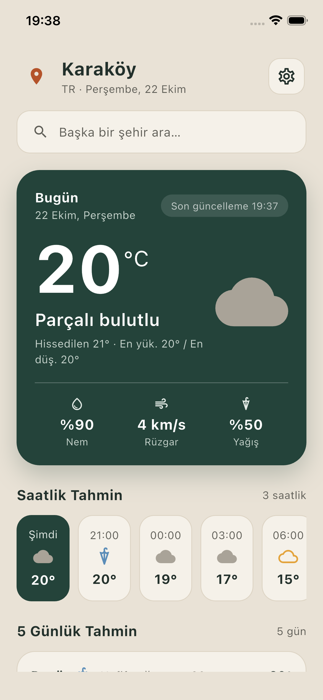
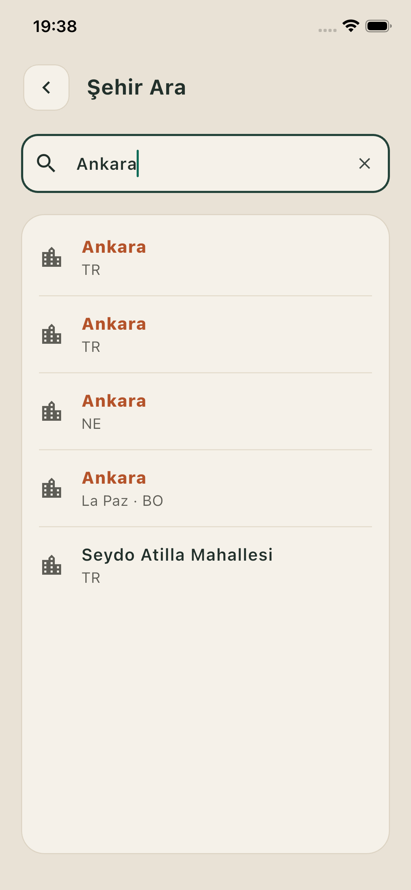

# Hava Durumu

Konumuna göre anlık hava durumunu, saatlik tahmini ve 5 günlük tahmini gösteren Flutter mobil uygulaması. Veriler [OpenWeatherMap](https://openweathermap.org/) API'sinden alınır.

<p align="center">
  
  &nbsp;&nbsp;
  
</p>

## Özellikler

- **Konuma göre hava durumu:** Cihaz konumu alınır, bulunulan şehrin havası gösterilir.
- **Anlık durum:** Sıcaklık, hissedilen sıcaklık, nem, rüzgar ve yağış olasılığı.
- **Saatlik tahmin:** Önümüzdeki 24 saat, 3 saatlik aralıklarla, yatay kaydırılabilir şerit.
- **5 günlük tahmin:** Günlük en düşük ve en yüksek sıcaklık, haftalık ölçekte karşılaştırmalı sıcaklık çubukları.
- **Şehir arama:** Yazarken anlık arama (debounce ile), eşleşen harflerin vurgulanması.
- **Konuma dönüş:** Başka bir şehre bakarken tek dokunuşla kendi konumuna dönüş.
- **Anlaşılır hata mesajları:** İnternet yok, izin reddedildi, zaman aşımı gibi durumlar için kullanıcı dostu mesajlar ve "Tekrar dene" butonu.
- **Türkçe arayüz:** Türkçe gün ve ay adları, Türkçe hava durumu açıklamaları.

## Kullanılan teknolojiler

|                    |                                                                                                                                       |
| ------------------ | ------------------------------------------------------------------------------------------------------------------------------------- |
| Framework          | Flutter 3.47 / Dart 3.13                                                                                                              |
| Hava durumu verisi | OpenWeatherMap: Current Weather, 5 Day / 3 Hour Forecast, Geocoding API                                                               |
| Paketler           | [`http`](https://pub.dev/packages/http), [`geolocator`](https://pub.dev/packages/geolocator), [`intl`](https://pub.dev/packages/intl) |
| State yönetimi     | `StatefulWidget` + `setState`                                                                                                         |

## Proje yapısı

```
lib/
├── main.dart                   # Uygulama girişi, tema, Türkçe tarih ayarı
├── models/                     # JSON → Dart nesneleri
│   ├── weather.dart            #   Anlık hava durumu
│   ├── forecast.dart           #   Saatlik tahmin + günlere gruplama algoritması
│   └── city.dart               #   Şehir arama sonucu
├── services/                   # Dış dünyayla iletişim
│   ├── weather_service.dart    #   OpenWeatherMap istekleri, hata yönetimi
│   └── location_service.dart   #   Konum izni ve konum alma
├── screens/
│   ├── home_screen.dart        # Ana ekran
│   └── search_screen.dart      # Şehir arama ekranı
├── widgets/                    # Tekrar kullanılabilir arayüz parçaları
├── theme/app_colors.dart       # Renk paleti
└── utils/                      # Yardımcılar (hata sınıfı, Türkçe büyük harf)
```

Katmanlar birbirinden ayrıdır: **servisler** veriyi çeker, **modeller** JSON'u tipli nesnelere çevirir, **ekranlar** sadece bu nesneleri gösterir. Arayüz HTTP'yi, servisler de widget'ları bilmez.

## Kurulum

### 1. Gereksinimler

- [Flutter SDK](https://docs.flutter.dev/get-started/install) (3.x)
- Ücretsiz bir [OpenWeatherMap API anahtarı](https://home.openweathermap.org/users/sign_up). Kayıt sonrası **My API keys** sayfasında bulunur. Yeni anahtarların aktif olması biraz zaman alabilir.

### 2. Projeyi indir

```bash
git clone https://github.com/ismailemretataroglu/hava_durumu.git
cd hava_durumu
flutter pub get
```

### 3. API anahtarını ekle

Örnek ayar dosyasını kopyala ve içine kendi anahtarını yaz:

```bash
cp config.example.json config.json
```

```json
{
  "OWM_API_KEY": "senin_api_anahtarin"
}
```

> `config.json` dosyası `.gitignore` içindedir ve repoya yüklenmez.

### 4. Çalıştır

```bash
flutter run --dart-define-from-file=config.json
```

VS Code kullanıyorsan ▶ **Run** butonu bu ayarı `.vscode/launch.json` üzerinden otomatik olarak kullanır.

> **Emülatör notu:** Emülatör ve simülatörler varsayılan olarak Kaliforniya'da sahte bir konum kullanır. Kendi şehrini görmek için emülatörün konum ayarından özel bir konum gir.

## Testler

```bash
flutter test
```

Günlere gruplama algoritması (`DailyForecast.groupByDay`) ve Türkçe büyük harf yardımcısı (`capitalizeTr`) için birim testleri bulunur.

## Güvenlik notu

API anahtarı koda yazılmaz; derleme sırasında `--dart-define-from-file` ile verilir ve repoda bulunmaz. Ancak derlenmiş uygulamanın içine gömüldüğü için, uygulama mağazada yayınlanacaksa istekler kendi sunucunuz üzerinden (proxy) yapılmalıdır. Bu proje öğrenme ve portfolyo amaçlıdır.

## Desteklenen platformlar

| Platform       | Durum |
| -------------- | ----- |
| iOS            | ✅    |
| Android        | ✅    |
| Web / masaüstü | ✅    |

## Geliştirici

**İsmail Emre Tataroğlu**: [GitHub](https://github.com/ismailemretataroglu)
